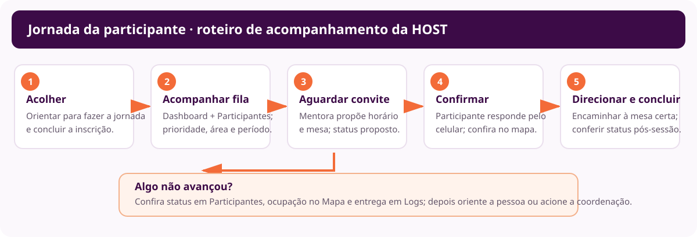
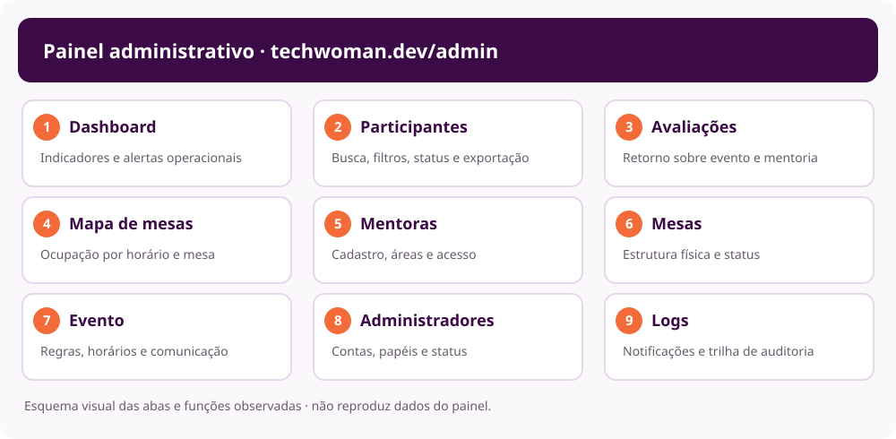

# Manual de operação para hosts — Tech Woman

**Edição:** 8 de novembro de 2026 · **Site:** [techwoman.dev](https://techwoman.dev/)  
**Objetivo:** orientar hosts que acolhem participantes, acompanham a fila de mentoria e ajudam a manter as mesas e os agendamentos fluindo.

> A host é o ponto de apoio entre participante, mentora e operação do evento. Este manual prioriza o que observar, o que orientar e quando chamar a coordenação. Os diagramas são esquemas visuais do processo; não são capturas de tela e não contêm dados pessoais.

## Roteiro visual do atendimento

**Caminho curto:** acolher → orientar a jornada e inscrição → acompanhar a fila → conferir convite e confirmação → direcionar à mesa → verificar o fechamento da sessão.

## 1. Papel da host

A host ajuda cada participante a entender o próximo passo e mantém a operação organizada. A host **não promete uma mentoria**, não confirma por conta própria o convite da participante e não altera disponibilidade ou agenda sem autorização.

O site informa que a inscrição não garante vaga. A mentora propõe horário e mesa; a participante confirma pelo celular. Sempre confira o status atual antes de encaminhar alguém para uma mesa.

- **Perfil Admin:** operação do evento e acompanhamento das telas administrativas.
- **Perfil Super admin:** inclui configurações do evento, estrutura de mesas e acessos. Essas funções só devem ser usadas pela pessoa responsável pela configuração.
- **Área da mentora:** fila e agenda da própria mentora. A host pode orientar a mentora a usar essa área, mas não deve agir em nome dela sem autorização.

## 2. Antes de abrir as mesas

### 2.1 Entrar e fazer a leitura inicial

1. Acesse [techwoman.dev/admin](https://techwoman.dev/admin) com a conta de host autorizada.
2. Confirme seu perfil no painel. Se uma opção não aparecer, peça acesso à coordenação; não use a conta de outra pessoa.
3. No **Dashboard**, veja a fila, convites pendentes, confirmações, sessões concluídas, faltas, mesas ocupadas e capacidade restante.
4. Leia a área **Precisa de atenção**. Um atalho como **Agendar manualmente** leva à lista de participantes; confira status e filtros antes de qualquer encaminhamento.
5. No **Mapa de mesas**, veja **Dia inteiro** para entender a grade toda. Confira quantas mesas estão ativas e onde ficam.

### 2.2 Preparar a operação

- Confira se as mentoras estão ativas, se já acessaram o portal e quais áreas atendem. A tela **Mentoras** mostra status, temas e horários disponíveis.
- Compare a disponibilidade das mentoras com a grade no **Mapa de mesas**.
- Confirme fisicamente a identificação das mesas com a numeração exibida no mapa.
- Saiba quem é a pessoa de coordenação/Super admin para acionar quando for necessário alterar configurações, cadastro de acesso ou capacidade.
- Deixe abertas as telas de **Dashboard**, **Participantes** e **Mapa de mesas**; o Dashboard se atualiza periodicamente (a tela consultada indicou intervalo de 15 segundos).

**Horário do evento:** o site informa 14 de novembro de 2026 e o Recife Expo Center. A configuração administrativa consultada exibia a grade de sessões entre **10h e 16h45** (horário local de Recife), com intervalos de **45 minutos**. Reconfirme o horário oficial com a coordenação antes do início.

## 3. Acolher e orientar a participante

Quando alguém chegar ao ponto de apoio:

1. Pergunte em que etapa está: descoberta da área, inscrição, espera por convite, confirmação ou localização da mesa.
2. Se ainda não fez a jornada, mostre [techwoman.dev/jornada](https://techwoman.dev/jornada) e explique que são sete etapas rápidas para sugerir área, nível e perfil.
3. Oriente a pessoa a se inscrever na área de interesse e informar o período de preferência.
4. Explique com clareza: **a inscrição não garante vaga**; a mentora envia uma proposta conforme a agenda disponível.
5. Se já estiver esperando, confirme o nome usado na inscrição e procure na aba **Participantes**. Evite pedir ou repetir informações pessoais em voz alta.

As trilhas públicas incluem Carreiras, Técnica, Soft Skills, Empreendedorismo e Tecnologia para quem não é da tecnologia. Se a pessoa não souber qual escolher, ajude-a a explorar a jornada e o diretório de [mentoras](https://techwoman.dev/mentoras); a escolha final é dela.

## 4. Monitorar fila e agendamentos

### 4.1 Use o Dashboard como radar

Acompanhe principalmente:

- **Aguardando:** há pessoas na fila que ainda precisam de atendimento.
- **Convites pendentes:** propostas aguardando resposta da participante.
- **Confirmadas:** sessões que devem ser encaminhadas para mesa e horário corretos.
- **Concluídas / Não compareceu:** resultado da sessão, útil para atualizar o fluxo.
- **Mesas ocupadas / capacidade restante:** visão rápida da operação física.
- **Precisa de atenção:** casos destacados, como pessoas com prioridade na fila.

Os números mudam; confira a tela novamente antes de orientar ou tomar uma decisão.

### 4.2 Localize uma inscrição

1. Abra **Participantes**.
2. Pesquise por nome, e-mail ou telefone; confirme a pessoa com discrição.
3. Filtre por **Status**, **Área**, **Período preferido** ou **Prioridade**.
4. Use o período e a área para localizar uma mentora compatível. A prioridade ajuda a ordenar o atendimento, mas não substitui a checagem da agenda.
5. Leia o status antes de agir. Não tente encaixar alguém em uma mesa que aparece ocupada ou em um horário que não foi confirmado.

A lista tem opção de exportar CSV. Para o trabalho cotidiano, prefira os filtros na tela; o CSV contém dados pessoais e deve ser exportado somente quando necessário e guardado em local autorizado.

### 4.3 Entenda os status

- **Aguardando** — ainda sem horário proposto. Confira área, período e prioridade; acompanhe a disponibilidade.
- **Horário proposto** — a mentora enviou uma proposta, mas falta a resposta da participante. Oriente-a a verificar o convite e responder pelo celular.
- **Confirmada** — a sessão foi aceita. Confira horário e mesa no mapa e encaminhe as duas pessoas.
- **Concluída** — atendimento registrado como realizado. Oriente sobre a avaliação e libere o fluxo conforme a operação.
- **Não compareceu** — o sistema registrou ausência. Confirme o contexto com a coordenação antes de qualquer ajuste.
- **Cancelada** — atendimento cancelado. Confira mapa e fila antes de chamar alguém para aquele horário.
## 5. Conferir mesa e encaminhar a sessão

1. Abra **Mapa de mesas** e selecione **Agora** para ver a ocupação no momento.
2. Localize a linha do horário e a coluna da mesa indicados na sessão confirmada.
3. Confira a legenda: **Horário proposto**, **Confirmada**, **Concluída**, **Não compareceu** e **Livre**.
4. Encaminhe a participante somente quando a sessão estiver **Confirmada**. Informe mesa e horário com clareza.
5. Se o mapa e a informação recebida não coincidirem, não improvise uma troca: confirme com a mentora e acione a coordenação.
6. Depois do horário, confira se a sessão foi concluída ou se houve ausência/cancelamento.

O mapa consultado organiza **23 mesas × 9 horários**. A grade pode exigir rolagem horizontal para mostrar todas as mesas. Use **Dia inteiro** para planejamento e **Agora** durante a operação.

## 6. Situações comuns: o que fazer

### A participante não encontra a inscrição

- Confirme como ela escreveu o nome/e-mail, sem expor esses dados a outras pessoas.
- Em **Participantes**, pesquise e filtre por status/área.
- Se não aparecer, verifique se a inscrição foi concluída na jornada; encaminhe para a organização se continuar sem localizar.

### A participante está aguardando há bastante tempo

- Veja se está como **Aguardando** e se há indicação de prioridade.
- Confira área, período e horários disponíveis no Dashboard/área de mentoras.
- Explique que a fila depende da disponibilidade real e não prometa horário.
- Acione a coordenação se a prioridade precisar de revisão ou se houver bloqueio operacional.

### O convite não chegou ou está pendente

- Peça que a participante confira o celular e o e-mail usado na inscrição.
- Veja se o status é **Horário proposto** ou **Confirmada**.
- Se o envio parecer falho, consulte **Logs → Notificações**, filtrando por destinatário/canal/status, ou peça ajuda à coordenação. A tela mascara destinatários; não compartilhe capturas/exportações com dados de contato.
- Não crie outro agendamento para contornar um convite pendente sem confirmar o estado atual.

### O horário ou a mesa não aparece livre

- Confira **Agora** e o horário exato no mapa; revise a legenda e role a grade horizontalmente.
- Se houver conflito, mantenha a participante fora da mesa até a coordenação ou mentora confirmar a correção.
- O host com perfil Admin não altera a grade geral do evento; isso é configuração de Super admin.

### Cancelamento ou não comparecimento

- Confira o status atual em **Participantes**, **Dashboard** e **Mapa**.
- Avise a coordenação e siga o procedimento do evento para liberar a mesa ou chamar alguém da fila.
- Não marque uma ausência ou conclusão por suposição; o registro precisa refletir o que ocorreu.

### Conversa aconteceu fora da mesa

A mentora pode usar **Registrar atendimento fora da mesa** na própria agenda. Oriente a mentora a fazer o registro após a conversa. A host não deve criar esse registro em nome dela sem autorização.

## 7. Acompanhar a experiência da mentora

Se a mentora precisar de ajuda, oriente-a para [techwoman.dev/entrar](https://techwoman.dev/entrar) e para as abas **Aguardando**, **Minha agenda** e **Disponibilidade**. Ela pode buscar participantes por nome/assunto, filtrar por área/período/prioridade, revisar sessões do dia e marcar seus horários disponíveis.

Se a mentora não consegue acessar, aparece como desativada ou não consegue alterar disponibilidade, encaminhe o caso para a coordenação/Super admin. **Redefinir senha**, **ativar/desativar mentora** e **alterar cadastro** são ações administrativas e não fazem parte do atendimento normal da host.

## 8. Fechar o turno

- Confira no Dashboard sessões concluídas, pendentes, canceladas e não comparecimentos.
- Confirme com a coordenação se há participantes que ainda precisam de orientação.
- Verifique se as mesas ficaram livres ou se há ocorrência para registrar.
- Se alguém relata não ter recebido mensagem, anote o caso conforme procedimento interno e encaminhe para conferência em Logs.
- Saia do painel em computador compartilhado.

## 9. Referência rápida das abas administrativas

- **Dashboard** — acompanhe fila, convites, sessões, faltas, ocupação e alertas durante o turno.
- **Participantes** — localize inscrições e filtre por status, área, período e prioridade.
- **Avaliações** — confira o retorno após as sessões concluídas.
- **Mapa de mesas** — confirme mesa e horário antes de encaminhar participantes.
- **Mentoras** — consulte áreas, temas, disponibilidade e acesso; cadastro e redefinição de senha ficam com a coordenação.
- **Mesas** — confira número e situação; alterações estruturais são de Super admin.
- **Evento** — consulte grade e regras; alterações são de Super admin.
- **Administradores** — gerenciamento de papéis e acessos; não costuma ser necessário durante o turno.
- **Logs** — investigue falhas de notificação e confira a trilha de auditoria; proteja os dados pessoais.| [Logs](https://techwoman.dev/admin/logs) | Investigar convite ou notificação com falha. | Canal, modelo, status e trilha de auditoria. Proteja os dados ao consultar/exportar. |

## 10. Jornada completa em uma frase

**Acolha a pessoa, ajude-a a concluir a jornada e a inscrição, acompanhe a fila sem prometer vaga, confirme o status antes de encaminhar para uma mesa e peça apoio da coordenação sempre que agenda, mesa ou registro divergirem.**

## Páginas de apoio

- [Site e evento](https://techwoman.dev/)
- [Jornada da participante](https://techwoman.dev/jornada)
- [Diretório de mentoras](https://techwoman.dev/mentoras)
- [Portal da mentora](https://techwoman.dev/entrar)
- [Painel administrativo](https://techwoman.dev/admin)

*Manual orientativo para hosts, baseado nas telas consultadas em 8/11/2026. Os dados do evento e os controles podem mudar; prevalecem as instruções atuais da coordenação.*

